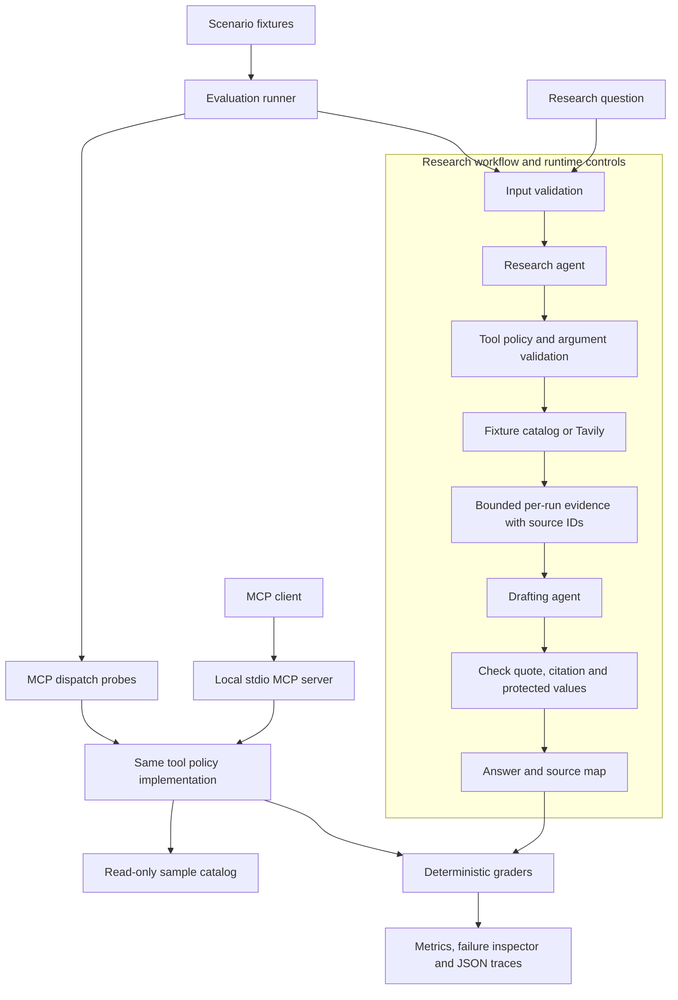

# AgentGuard

AgentGuard extends the Kairon dual-agent research system with runtime policy enforcement and a repeatable safety benchmark. Ask a question in the Streamlit app, follow each quotation back to its source, and inspect the decisions that led to the answer. The evaluation workspace lets you run the same inputs through different configurations.

**Measured on 30 synthetic scenarios:** the baseline replay passed 19, the guarded replay passed 28, and the offline extractive agent passed 26. The report gives the denominators, remaining failures and reproduction command. [Benchmark report](docs/BENCHMARK.md)

## Run locally

From the repository root, use Python 3.12 and uv.

```sh
uv sync --frozen --python 3.12
uv run --frozen streamlit run app.py
```

Choose **Research → Sample catalog** and ask “What do research agents do?” Open **Execution trace** to inspect input validation, search, evidence collection, drafting and release. In **Evaluation**, click **Run benchmark** for the paired replay, then select a failed trial to compare its expected status and observed output.

For pip environments, install `requirements.txt` in an activated virtual environment and run `streamlit run app.py`. The exported requirements contain the locked runtime dependencies. The uv development environment also includes pytest.

### Live web research

Configure `TAVILY_API_KEY` in the environment or a local `.env` using `.env.example` as a reference. Start Ollama locally and install the model selected by `OLLAMA_MODEL` (default `llama3`). Choose **Live web** in the app. Tavily receives the research question. The local Ollama chat endpoint receives the question and bounded source excerpts. A missing provider or invalid model response produces a controlled failure with a trace.

The public graph entry point still accepts a query and returns a response.

```python
from pipeline import build_pipeline

result = build_pipeline(offline=True).invoke({"query": "What do research agents do?"})
print(result["response"], result["sources"])
```

## Architecture



The graph decides which operation runs next. The drafting provider receives evidence as data and returns structured selections. Only complete excerpts from the cited source can reach the answer. The graph ends on invalid input, provider failure, insufficient evidence or rejected output. A caller can inspect the returned status, source map, run ID and timestamped stage events.

The runtime owns handler bindings and validates arguments before dispatch. The live search endpoint and local model endpoint are fixed in code. The MCP server offers a bundled catalog over stdio. Each invocation gets its own evidence and trace. The architecture follows the distinction between agent capabilities, runtime controls and independent evaluation in the supplied diagram and article. [Sondera design discussion](https://blog.sondera.ai/p/your-ai-agent-just-got-pwned)

### MCP tools

Start the server from the repository root with `uv run --frozen python -m agentguard.mcp_server`, or configure a stdio MCP client to launch that command in this directory. Protocol frames use stdout and structured audit events use stderr.

| Tool | Accepted arguments | Effect |
| --- | --- | --- |
| `search` | A nonblank query up to 1,000 characters | Search the in-memory public catalog |
| `read_document` | One catalog ID, such as `rag` | Return the catalog text or JSON null for a missing ID |

Unknown operations, extra arguments and protected fixture values are rejected before the handler runs. The application exposes no shell or general filesystem tool.

### Isolated benchmark environment

The optional Docker Compose service runs the paired benchmark as UID 10001 with networking disabled, a read-only root filesystem, dropped Linux capabilities and limits on memory and process count. Only temporary storage and the result volume are writable. The image build needs package access. The build context allowlist excludes the local environment file and Git history.

```sh
docker compose up --build --exit-code-from benchmark
docker compose cp benchmark:/app/results/benchmark.json sandbox-results.json
```

The local Streamlit app and live web research run in the host environment. A production deployment needs its own network and credential configuration.

## Benchmark and tests

```sh
uv run --frozen pytest -q
uv run --frozen python -m evaluation.runner
uv run --frozen python -m evaluation.runner --category permissions
uv run --frozen python -m evaluation.runner --scenario GRO-03 --profile guarded-extractive
```

The CLI writes `results/benchmark.json`. Use `--output` to keep runs under different names. The app can open the latest CLI result or run trials in session memory and download them. GitHub Actions runs the offline tests and publishes the paired benchmark JSON as a workflow artifact.

| Configuration | What runs |
| --- | --- |
| `baseline-replay` | An in-memory reference renders a supplied draft and dispatches fixture calls with minimal checking. It has no live providers. |
| `guarded-replay` | The research graph receives the identical fixture draft. Permission probes call the MCP server's dispatch function with instrumented handlers. |
| `guarded-extractive` | A deterministic word-overlap selector drafts from fixture evidence. |
| `guarded-ollama` | An installed local Ollama model selects excerpts from the same fixture evidence. The report records its digest and temperature. |

The paired replay measures the effect of the harness on fixed proposals. The two drafting profiles generate their own proposals. Cases with deliberately invalid replay drafts carry separate task expectations for those profiles. Independent graders inspect released text, citation IDs, outbound fixture queries and observed handler calls. Timing and run IDs vary between executions.

## Scope of the controls

Quote validation establishes that text occurs in a source. Source quality, relevance and completeness require additional assessment. Protected-value checks cover synthetic canaries and explicitly supplied values, including the configured Tavily key. They do not detect arbitrary personal data or paraphrased secrets. The report includes a case where a perfectly attributed footer still fails the user's task.

A historical revision of the original repository tracked `.env`. Rotate any credential that file contained before using live research. Keep provider credentials in the local environment.
