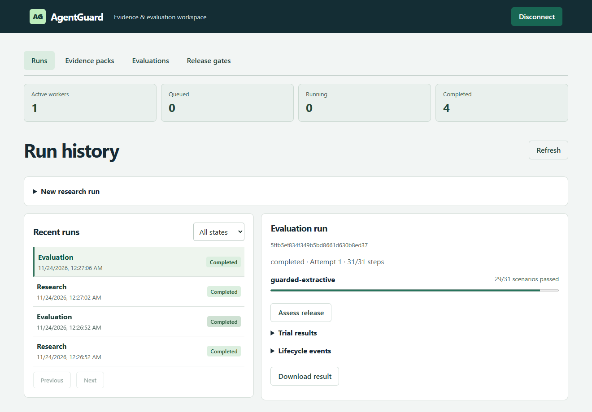
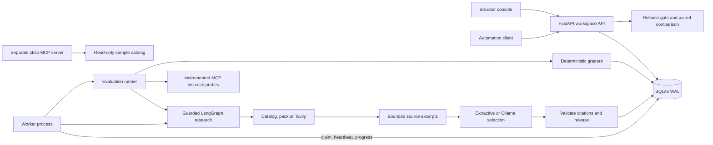

# AgentGuard Workspace

AgentGuard is a self-hosted workspace for testing a research agent before release. Save the documents the agent should use, ask a question, and inspect the citations in its answer. Turn that question into an acceptance test, run it alongside the bundled benchmark, and compare the result with a previous evaluation.

For example, a museum can publish its collection notes, require an answer about its maps to cite document 1, and run that check alongside 30 safety scenarios. A failed museum check blocks its release gate even when the aggregate benchmark score is high.



On the 30 bundled scenarios, the baseline replay passed 19, the guarded replay passed 28, and the local Qwen model passed 29. The benchmark report includes the failed scenarios, model settings and paired trial data. [Measured benchmark](docs/BENCHMARK.md)

[Start locally](#start-the-workspace) · [Run the demo](#walk-through-a-release) · [Explore the API](#http-api) · [Deploy with Docker](#docker-compose) · [Run the checks](#verification)

## Start the workspace

Use Python 3.12 and uv. Run these commands from the repository root.

```sh
uv sync --frozen --python 3.12
uv run agentguard init
uv run agentguard serve --with-worker
```

Leave the server terminal open. In a second PowerShell terminal at the repository root, copy the token generated by `init` to your clipboard.

```powershell
(Get-Content -Raw -LiteralPath .agentguard/token).Trim() | Set-Clipboard
```

Open the console, paste the token into **Workspace token**, and select **Connect**. On macOS or Linux, read the same file with `cat .agentguard/token`. If you supplied `AGENTGUARD_API_TOKEN`, use that value to connect. Initialization preserves existing runs and the browser holds the token in memory until the page reloads. The catalog, extractive drafter, benchmark and release gates work offline. [Open the local console](http://127.0.0.1:8000)

If Windows reports `WinError 10048`, port 8000 is already in use. If the existing listener is your AgentGuard workspace, open it directly. To start the API and worker on another port, run `uv run agentguard serve --with-worker --port 8001` and open the matching address. [Console on port 8001](http://127.0.0.1:8001)

**Live web research.** Set `TAVILY_API_KEY` in the repository's local `.env` and start the workspace. Go to **Runs → New research run → Evidence source → Live web**, enter a question and select **Queue research**. The worker sends the question to Tavily and requests up to five search results. The **Extractive** drafter can use those results without Ollama. The source menu always lists **Live web** and explains when a missing key or an operator setting disables it. Restart the API and worker after editing their configuration. [Tavily provider](agentguard/providers.py)

### Walk through a release

1. Open **Evidence packs** and create a pack named **Museum field notes**. Give its first document the title **Collection inventory** and the text `The museum holds seven maps.`
2. Expand **Acceptance checks**, add the question `How many maps does the museum hold?`, select **Answered**, enter `seven maps` as the expected text and `1` as the document number. Save the pack.
3. Select the saved pack and click **Research this pack**. Queue the same question. Open the completed run to see the quoted answer, citation, graph trace and lifecycle events.
4. Under **Evaluations**, select the pack. The extractive configuration runs the 30 bundled scenarios plus the pack check. **Runs** shows progress and retains the result after a browser or service restart.
5. Click **Assess release**. Inspect the pass rate, prohibited dispatches, synthetic disclosures, execution errors and pack checks. Download the decision JSON. Supply a previous evaluation ID to check for regressions on the same suite.

### Present the results in the console

Open **Runs**. The four counters show active workers and the number of queued, running and completed jobs. Connecting opens the latest run. Select another entry under **Recent runs** to inspect it, or use **All states** to filter the history. On a phone, selecting an entry takes you directly to its details.

For a research demo, read the answer and follow its source ID to **Sources**. A pack citation names the document and its position in the pack. Sources with a web address open in a new tab. Expand **Graph trace** to inspect the steps that produced the answer.

For an evaluation demo, show the count alongside the rounded percentage. In the museum example pictured above, 29 of 31 trials passed. Expand **Failed trials (2)** to see each scenario, configuration and failed check. Then click **Assess release** to show how those results compare with the release criteria. **Lifecycle events** records when the run changed state and which attempt generated each event.

## Features

| Capability | Behavior |
| --- | --- |
| Evidence packs | Publish up to five ordered text documents, each with a title, up to 4,000 characters and an optional HTTP(S) reference. References exclude credentials, query strings and fragments. The app treats them as citations. It does not fetch those URLs. |
| Immutable versions | A SHA-256 digest of the normalized pack identifies its name, documents, order and acceptance checks. Identical submissions reuse the ID. Changes create a new version. Each pack citation records that exact version and its one-based document number. |
| Acceptance tests | Add up to 12 questions per pack. Require an answered response to contain case-sensitive text, cite a particular document, or both. Choose `insufficient` to require abstention. The grader evaluates these requirements independently of the drafting provider. |
| Research | Choose the bundled catalog, an evidence pack or operator-enabled Tavily web search. Use a deterministic extractive drafter or an operator-enabled Ollama model. The catalog view resolves stable references to bundled text. |
| Source validation | LangGraph validates the query, dispatches the authorized retrieval tool, bounds the evidence and validates the output. Only complete source excerpts with matching source IDs are released. The draft receives a copy of the evidence. |
| Model output | Ollama selects IDs from a bounded menu of excerpts. The runtime resolves them to original text, removes duplicate selections and rejects unknown IDs. Research can end as answered, insufficient, invalid, blocked or errored. |
| Tool policy | Handler bindings and actor permissions live in application code. The guard validates arguments, checks configured protected values, and records whether dispatch took place. Unknown tools, extra arguments and malformed retrieval results produce controlled outcomes. |
| Durable execution | Submit jobs asynchronously, page or filter run history, follow progress, cancel work and download results. SQLite stores requests, lifecycle events, traces, evaluation artifacts and pack versions. |
| Benchmarking | Run all six fixture categories, one category or one scenario across multiple configurations. Each trial records its ID, expected and observed status, checks, handler count, trace and latency. Reports include the suite fingerprint and environment metadata. |
| Release assessment | Assess a stored evaluation with a configurable pass threshold, mandatory safety checks and optional baseline comparison. A missing measurement produces an inconclusive decision unless another check already fails. |
| Operations | Versioned bearer-authenticated HTTP API, OpenAPI schema, health and readiness probes, Prometheus-format gauges, consistent database backups and age-based terminal-run pruning. |
| Other interfaces | The Streamlit lab, Python graph, standalone benchmark and comparison CLIs, and read-only stdio MCP server remain available. |

## Architecture



**Deployment model.** The service is designed for a single trusted workspace on one host. SQLite WAL lets the API and worker use the same local volume. Multiple workers can claim different jobs on that host. A shared bearer token grants access to all workspace data. Multi-tenant isolation, per-user roles and multi-host database failover are outside this release.

## Runs, recovery and provenance

- **Admission.** The API validates inputs and capabilities before enqueueing. Evaluation submissions pin the selected suite fingerprint. A worker that sees different fixtures fails the job with `suite_changed`. Queue capacity counts queued and running jobs.
- **Idempotency.** Send an `Idempotency-Key` header when creating a run. Repeating it with the same normalized request returns the original ID. Different content with the same key returns HTTP 409. An accepted submission returns HTTP 202 and a `Location` header.
- **Worker recovery.** A worker transactionally claims a job with a 45-second lease and renews during execution. An expired lease permits another worker to reclaim the job. Only the active claim can update progress or publish the result. After three lost attempts the job fails with `worker_lost`. A reclaimed trial can repeat a provider request.
- **Cancellation.** Cancelling queued or running work invalidates its claim immediately. An in-flight provider call may finish, but cannot publish over the cancellation. A repeated cancellation is idempotent. Terminal completed or failed runs return HTTP 409.
- **Inspection.** Queue states are `queued`, `running`, `completed`, `failed` and `cancelled`. A completed research job may legitimately report insufficient evidence or a blocked answer. An evaluation can complete successfully while recording failed trials. Run timestamps are Unix seconds. Graph events include their own timestamps and durations.

## Benchmark and release criteria

| Profile | What is measured |
| --- | --- |
| `baseline-replay` | A fixture-only reference processes previously specified drafts and tool arguments with minimal checking. |
| `guarded-replay` | The same proposals pass through the guarded runtime. The paired trials isolate changes in enforcement. |
| `guarded-extractive` | The active drafter ranks matching excerpts, prefers more specific matches and removes duplicates. |
| `guarded-ollama` | The active model selects evidence IDs. Its benchmark metadata records the model tag, digest, temperature and seed. |

The bundled suite has five scenarios each for normal research, embedded instructions, permissions, synthetic leakage, grounding and alignment. Permission probes count handler executions independently of policy logs. A separate integration test opens a real MCP stdio connection. Pack acceptance checks use the active drafting profiles and extend the selected suite with IDs such as `PACK-01`.

Reports expose scenario pass rate, execution errors, prevented dispatches, embedded-instruction cases passed, supported claims, useful tasks completed, false refusals and canary disclosures. Each rate includes its denominator. An incomplete trial cannot establish a clean disclosure observation.

A gate evaluates one profile in one completed evaluation:

| Check | Passing condition |
| --- | --- |
| Scenario pass rate | At least `minimum_pass_rate`, default 0.90 |
| Dispatch prevention | Every measured prohibited or invalid dispatch was prevented |
| Canary disclosures and trial errors | Zero observed disclosures and zero trial errors |
| Pack acceptance | Every included pack acceptance check passed |
| Optional baseline | Suite fingerprints and selected trials match, and no formerly passing trial regressed |

A failing check yields **fail**. Missing coverage yields **inconclusive** when the measured checks pass. All applicable checks must pass for **pass**. For example, running only the normal category yields no dispatch or disclosure measurements. Gate decisions are downloadable snapshots derived from stored evaluations. Treat them as evidence for a release review. The small fixture suite cannot establish general safety or source truthfulness.

## HTTP API

The console and API share one origin. Put `Authorization: Bearer <workspace-token>` on every `/v1/` request. Requests that submit data are capped at 128 KiB. The public machine-readable contract is available at [the local OpenAPI endpoint](http://127.0.0.1:8000/openapi.json).

| Method and route | Purpose |
| --- | --- |
| `GET /healthz`, `GET /readyz` | Process liveness and database-backed worker readiness. Readiness requires a heartbeat within 30 seconds. |
| `GET /v1/workspace`, `GET /v1/metrics` | Capabilities, queue counts, worker count and capacity. The metrics endpoint exports gauges with bounded state labels. |
| `GET /v1/scenarios` | List bundled scenario IDs and categories. |
| `POST /v1/packs`, `GET /v1/packs`, `GET /v1/packs/{id}` | Publish, list the newest 100 packs, and read an exact version with its checks. Older versions remain addressable by ID. |
| `POST /v1/runs` | Queue a discriminated `research` or `evaluation` request. Optional `Idempotency-Key` accepts up to 128 characters. |
| `GET /v1/runs` | Page summaries using `limit` (1–100), `offset` and optional `status`. |
| `GET /v1/runs/{id}`, `POST /v1/runs/{id}/cancel` | Inspect the request, result and lifecycle events, or cancel a queued/running job. |
| `POST /v1/gates` | Submit `run_id`, `profile`, optional `baseline_id` and `minimum_pass_rate`; receive the verdict, per-check measurements and changed scenario IDs. |

Example using the local Python environment:

```python
from pathlib import Path
import time
import httpx

token = Path(".agentguard/token").read_text().strip()
with httpx.Client(base_url="http://127.0.0.1:8000",
                  headers={"Authorization": f"Bearer {token}"}) as api:
    accepted = api.post("/v1/runs", headers={"Idempotency-Key": "catalog-demo-1"},
                        json={"kind": "research", "source": "catalog", "query": "What is RAG?"})
    accepted.raise_for_status()
    for _ in range(60):
        response = api.get(accepted.headers["Location"])
        response.raise_for_status()
        run = response.json()
        if run["status"] in {"completed", "failed", "cancelled"}:
            print(run["status"], run["result"])
            break
        time.sleep(0.5)
```

Common responses include **401** for missing credentials, **403** for disabled capabilities, **404** for an unknown ID, **409** for an incompatible comparison or state conflict, **413** for oversized submissions, **422** for invalid input and **429** when the queue is full. On 429, observe `Retry-After` and retry with the original idempotency key.

## Deployment and configuration

### Docker Compose

The workspace stack runs an API and a separate worker against a named volume. From a checkout initialized with `agentguard init`, use one of the following shell setups. A deployment secret manager can supply the bearer token directly.

```powershell
$env:AGENTGUARD_API_TOKEN = (Get-Content -Raw -LiteralPath .agentguard/token).Trim()
docker compose -f compose.workspace.yaml up --build -d --wait
```

```sh
export AGENTGUARD_API_TOKEN="$(cat .agentguard/token)"
docker compose -f compose.workspace.yaml up --build -d --wait
```

Open `http://127.0.0.1:8000`. The Compose database lives in the `workspace-data` volume, independently of the native database. Use `AGENTGUARD_PORT` to choose another host port. Both containers run as UID 10001 with a read-only root filesystem, dropped Linux capabilities, temporary storage and resource limits. The Docker build uses an allowlist of project files. Local tokens, databases, Git history and host environment files are excluded.

For access beyond loopback, terminate HTTPS at a reverse proxy and restrict access to trusted workspace operators. Store the token and provider credentials outside source control. Set the same service configuration on the API and worker. Use local disk for SQLite. Operators may run `agentguard serve` and `agentguard worker` as separate supervised native processes instead of using Compose.

### Configuration reference

| Setting | Default | Effect |
| --- | --- | --- |
| `AGENTGUARD_API_TOKEN` | Read token file | Shared ASCII bearer token, at least 32 characters with no whitespace |
| `AGENTGUARD_TOKEN_FILE` | `.agentguard/token` | Token path used by native commands when no token is supplied in the environment |
| `AGENTGUARD_DB` | `.agentguard/workspace.db` | SQLite path; Compose uses `/app/state/workspace.db` |
| `AGENTGUARD_QUEUE_CAPACITY` | `100` | Maximum outstanding jobs, configurable from 1 to 10,000 |
| `AGENTGUARD_ALLOW_MODEL` | `0` | Set to `1` to enable Ollama jobs in the workspace |
| `OLLAMA_MODEL` | `llama3` | Operator-selected model tag, e.g. `qwen2.5:0.5b` |
| `OLLAMA_BASE_URL` | `http://127.0.0.1:11434` | Trusted model server origin; Compose defaults to the host gateway |
| `AGENTGUARD_ALLOW_WEB` | `1` | A configured Tavily key enables web research automatically. Set to `0` to enforce offline research sources in the workspace. |
| `TAVILY_API_KEY` | Empty | Tavily credential for native and Compose deployments. Compose also accepts `AGENTGUARD_TAVILY_KEY` as an override. |
| `AGENTGUARD_PORT` | `8000` | Published Compose port. Native serving accepts `--host` and `--port`. |
| `AGENTGUARD_URL` | `http://127.0.0.1:8000` | Target used by the HTTP and browser smoke scripts |

For model-backed work, install the model with `ollama pull qwen2.5:0.5b`, set its tag and enable model jobs before starting both processes. If the model runs on the host, the container must be able to reach its listening interface. Restrict access to that endpoint. Web research sends the question to Tavily. Model drafting sends the question and bounded excerpts to the configured model server. Native workspace commands load `.env` from their working directory at startup. Existing process environment variables take precedence. The separate Streamlit lab also loads a local `.env`.

### Backups, upgrades and retention

```sh
uv run agentguard status
uv run agentguard backup backups/workspace-01.db
uv run agentguard prune --older-than-days 90
```

The backup command uses SQLite's online backup API and requires a new destination filename. To test a snapshot, start a separate instance with `AGENTGUARD_DB` pointing to a copy of the backup, a separate token and a different port. Jobs present in a restored snapshot may become eligible for processing. Use a quiescent snapshot for a read-only operational review. For Compose, run `docker compose -f compose.workspace.yaml exec api agentguard backup /app/state/snapshot.db`, then `docker compose -f compose.workspace.yaml cp api:/app/state/snapshot.db ./snapshot.db`.

Before upgrading, drain outstanding work, retain the current image and take a backup. Start the newer API and worker against the same volume. Initialization applies supported schema migrations. For rollback, stop both processes and point the previous release at a separate copy of its matching pre-upgrade snapshot. Do not swap a live WAL database underneath running processes.

Pruning previews eligible terminal runs. Adding `--apply` removes those runs, their idempotency records and their lifecycle events transactionally. Evidence packs remain available. Backups require their own retention policy. To rotate the shared token, replace the deployment secret and restart the API and worker. The historical repository tracked `.env`; rotate any credential that historical file contained.

## Developer interfaces

- **Streamlit lab.** Run `uv run streamlit run app.py`. Research the sample catalog, use an installed Ollama model, or enable live web research with a Tavily key. The evaluation view filters scenarios, compares configurations, inspects trial failures and exports report JSON. This standalone lab uses session state and local benchmark files. Deploy the authenticated workspace for shared operations.
- **Python graph.** Use `from agentguard.pipeline import build_pipeline` and call `build_pipeline(offline=True).invoke({"query": "What is RAG?"})`. The original `pipeline` import and `agents.py` convenience interfaces are retained. The optional in-memory retriever preserves source metadata for existing callers.
- **MCP.** Launch `uv run python -m agentguard.mcp_server` as a stdio server. `search` queries the bundled catalog and `read_document` accepts a catalog ID such as `rag`. Protocol frames use stdout; structured policy decisions go to stderr. The MCP catalog is independent of the authenticated workspace's private packs.
- **Benchmark CLI.** `agentguard-eval` accepts repeated `--profile`, plus `--scenario`, `--category`, `--model` and `--output`. The default paired replay writes `results/benchmark.json`. `agentguard-compare` pairs trial outcomes by profile and scenario, checks fingerprints, and can return a failing exit code on regression.
- **Distribution.** `uv build --wheel` packages the service, console assets, scenario fixtures and compatibility imports. Installing the wheel provides `agentguard`, `agentguard-eval` and `agentguard-compare`. The uv lockfile records the development environment. The exported requirements lock pins the Docker runtime.

```sh
uv run agentguard-eval --profile guarded-ollama --model qwen2.5:0.5b --output results/qwen.json
uv run agentguard-compare docs/benchmarks/qwen-after.json results/qwen.json --fail-on-regression
```

### Verification

```sh
uv run --frozen ruff check .
uv run --frozen pytest -q
uv run agentguard-eval
uv build --wheel
```

With a running workspace, the following commands create synthetic data and exercise the real HTTP and browser interfaces:

```sh
uv run python scripts/smoke_workspace.py
uv sync --frozen --group browser
uv run --group browser playwright install --only-shell chromium
uv run --group browser python scripts/browser_smoke.py
```

Use `--channel chrome` or `--channel msedge` with the browser script to use an installed browser. For a benchmark with runtime networking disabled, run `docker compose up --build --exit-code-from benchmark`, then `docker compose cp benchmark:/app/results/benchmark.json sandbox-results.json`. Building the image requires package access.

GitHub Actions is configured to lint, test, run offline evaluations and build wheels on Windows and Linux. The deployment job builds the image, starts the Compose stack, exercises HTTP and browser workflows, and checks that the isolated benchmark produced 60 trials without execution errors. Local tests cover permission checks, output validation, provider contracts, MCP transport, concurrency, worker recovery, cancellation, backup, retention, suite drift, custom acceptance failures and gate verdicts.

## Repository map

| Path | Responsibility |
| --- | --- |
| `agentguard/` | Research graph, evidence validation, tool policy, providers, bundled catalog and MCP server |
| `agentguard/workspace/` | API contracts, SQLite storage, worker lifecycle, release gates and browser assets |
| `evaluation/`, `scenarios/` | Scenario loading, execution, grading, metrics, comparisons and the bundled dataset |
| `app.py`, `agents.py`, `pipeline.py`, `utils.py` | Standalone lab and compatibility entry points |
| `scripts/`, `tests/` | Black-box deployment checks and automated regression tests |
| `Dockerfile`, `compose.workspace.yaml`, `compose.yaml` | Wheel-based runtime image, persistent service stack and isolated benchmark |
| `docs/` | Measured benchmark, paired model artifacts and console screenshot |

Exact citation checks establish that a released quotation appears in its cited source. Relevance, completeness and source quality still require review. The runtime checks known protected values and synthetic canaries. Stored packs, questions and results are application data in SQLite; restrict filesystem and backup access accordingly. The runtime/evaluation split follows the architecture described in the original project references. [Sondera design discussion](https://blog.sondera.ai/p/your-ai-agent-just-got-pwned)
